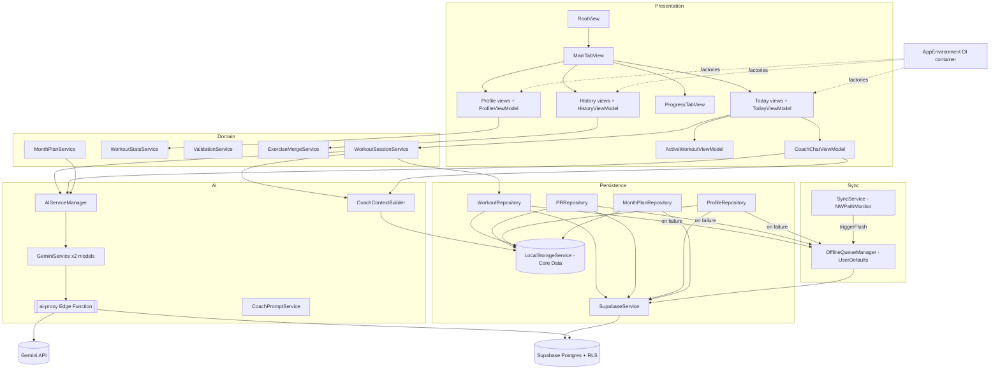
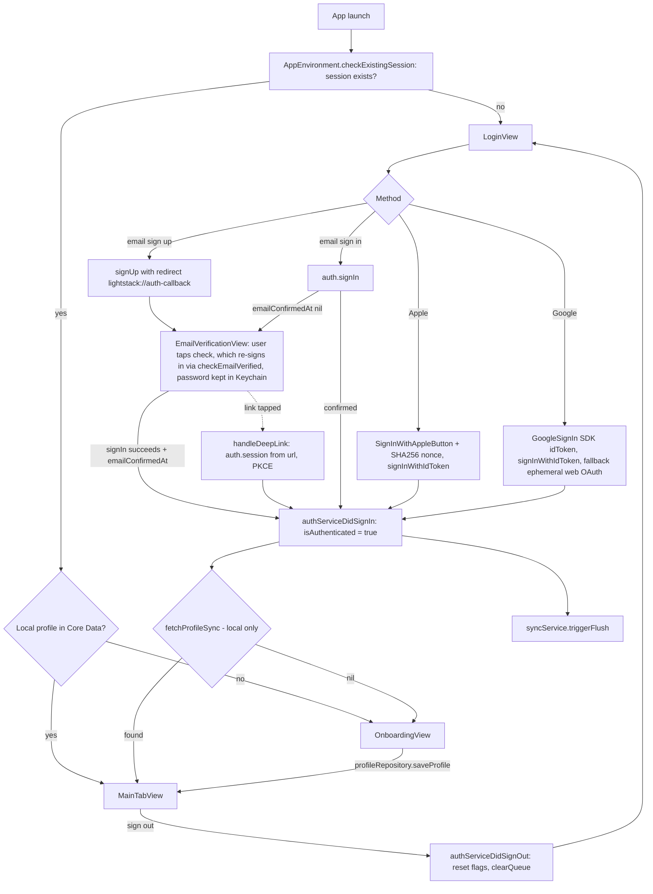
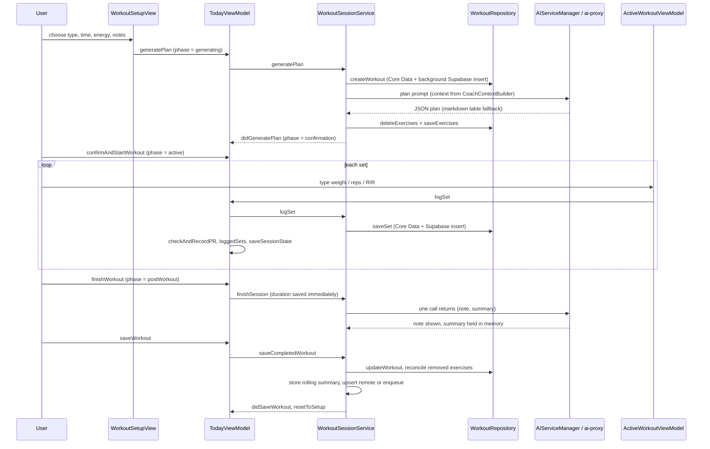
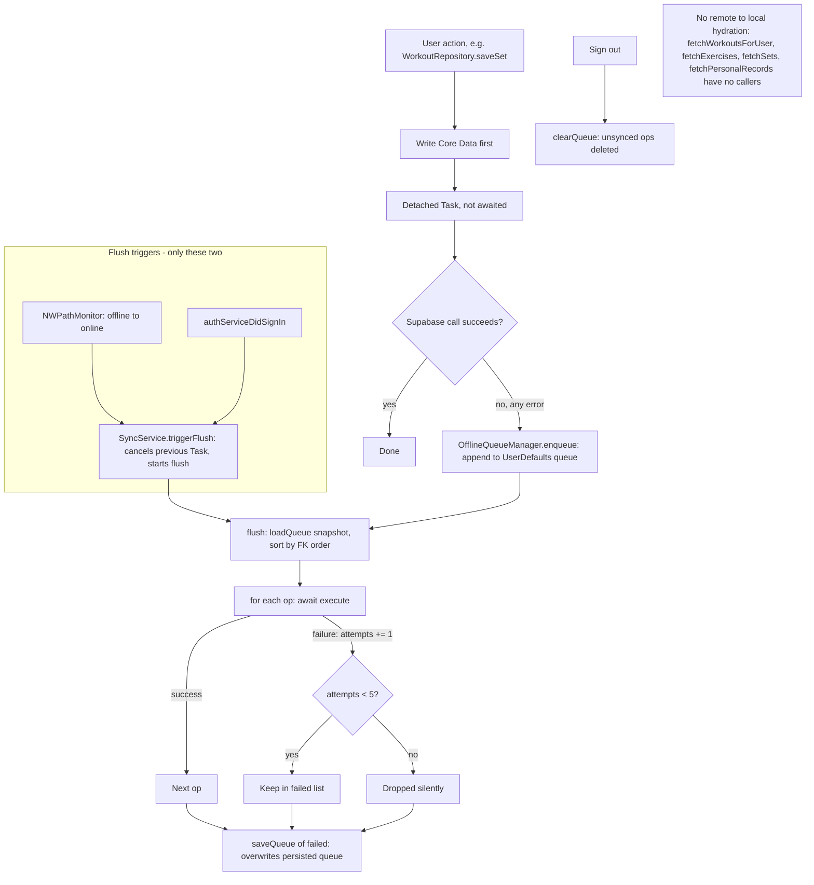
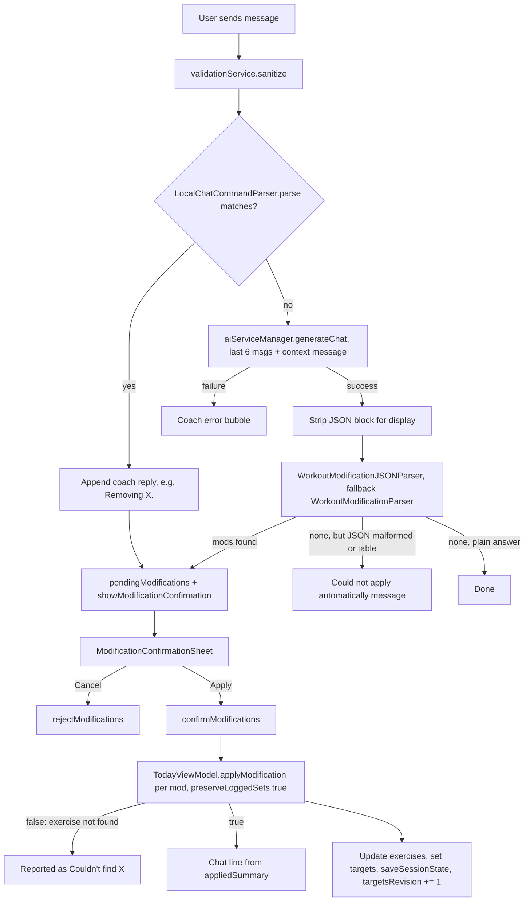
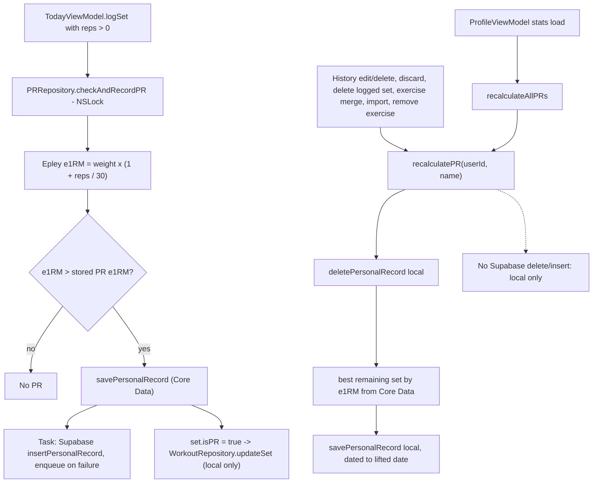
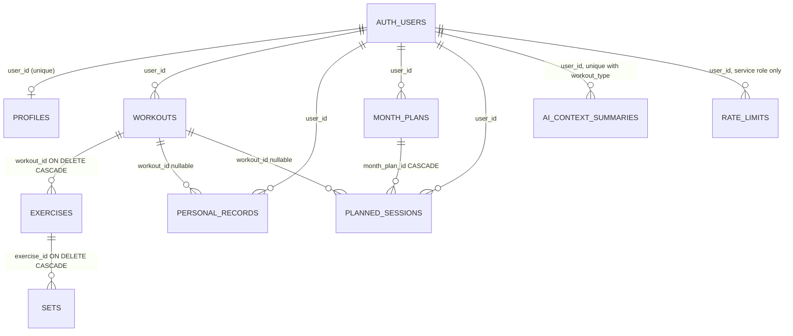

# Lightstack — System Architecture (as of main 5539be5)

Verified against the code on 2026-10-13. Paths are relative to the repo root; app code is under `Lightstack/`.

> **`docs/BLUEPRINT.md` is outdated.** It describes a two-tab Today/Month layout and a client-side Gemini key. Today the app has four tabs, Today / History / Progress / Profile (`App/MainTabView.swift`). A Month tab exists only behind `FeatureFlags.monthTabEnabled = false` (`Core/Utilities/FeatureFlags.swift`). AI calls go through the `ai-proxy` Supabase Edge Function (`supabase/functions/ai-proxy/index.ts`). No AI key ships in the app. Settings is no longer a tab; `Features/Settings/SettingsView.swift` still exists.

## 1. Architecture map

### Presentation
- **Entry:** `App/LightstackApp.swift` creates `AppEnvironment` and injects it as an environment object. `App/RootView.swift` routes on `AppEnvironment` flags in this order: `needsEmailVerification` shows `EmailVerificationView`; `!isAuthenticated` shows `LoginView`; `!hasCompletedOnboarding` shows `OnboardingView`; otherwise `MainTabView`.
- **Tabs:** `MainTabView` holds Today (`TodayTabContent`, backed by `TodayViewModel`), History (`HistoryListView`), Progress (`ProgressTabView`), Profile (`ProfileView`) and, only when the flag is on, Month (`MonthPlanView`).
- **ViewModels:**
  - `TodayViewModel` owns the Today phase machine `TodayPhase`: setup, generating, confirmation, active, postWorkout.
  - `ActiveWorkoutViewModel` handles live logging UI, the elapsed clock and rest timers.
  - `WorkoutSetupViewModel`, `HistoryViewModel`, `ProfileViewModel`, `CoachChatViewModel`, `MonthPlanViewModel`, `PlanBuilderViewModel`, `FormAnalysisViewModel`.
  - `ProgressTabView` has no ViewModel; it uses `Features/Progress/Services/ProgressStatsService.swift`.
- **Feature folders:** Today, History (incl. import), Progress, Profile, AICoach, Auth, MonthPlan, FormAnalysis, Settings. Theme lives in `Core/Theme`.

### Dependency management: `AppEnvironment` (`App/AppEnvironment.swift`)
A single DI container (`ObservableObject`, also the `AuthServiceDelegate`). Its `init` builds, in order:
- `SupabaseClient` (PKCE auth flow, `flowType: .pkce`, redirect `lightstack://auth-callback`).
- `AuthService`, `LocalStorageService` (then `removeDuplicateExercises()` at launch), `SupabaseService`, `OfflineQueueManager`, `SyncService`, `ValidationService`.
- Two `GeminiService` instances (`gemini-3.5-flash`, fallback `gemini-2.5-flash`) pointing at the proxy URL, wrapped in `AIServiceManager`. Under UI-test mode this is replaced by a fake provider.
- `WorkoutStatsService`, `WorkoutSessionPersistence`.
- Repositories: `ProfileRepository`, `WorkoutRepository`, `PRRepository`, `MonthPlanRepository`, and `ExerciseMergeService`.
- `CoachPromptService`, `CoachContextBuilder`, `WorkoutSessionService`, `MonthPlanService`, `NotificationService`.

Factories: `makeTodayViewModel`, `makeInlineTodayViewModel` (fresh `WorkoutSessionService`, for inline flows), `makeWorkoutSetupViewModel`, `makeActiveWorkoutViewModel`, `makeProfileViewModel`, `makeHistoryViewModel`, `makeCoachChatViewModel`, `makeMonthPlanViewModel`, `makePlanBuilderViewModel`.

Lifecycle hooks:
- `checkExistingSession()` at init sets `isAuthenticated` from the Supabase session and `hasCompletedOnboarding` from the local profile.
- `authServiceDidSignIn` sets auth flags, checks the local profile, and calls `syncService.triggerFlush()`.
- `authServiceDidSignOut` resets flags and calls `offlineQueueManager.clearQueue()`.
- `authServiceNeedsEmailVerification` and `authService(_:didFailWith:)` set the verification and error state.

### Domain / services
| Component | File | Notes |
|---|---|---|
| `WorkoutSessionService` | `Features/Today/Services/WorkoutSessionService.swift` | Plan generation, start/resume, log set, finish, save, rolling summary, plan parsing (JSON, then markdown fallback). Delegate: `WorkoutSessionServiceDelegate` (implemented by `TodayViewModel`). |
| `WorkoutStatsService` | `Core/Services/WorkoutStatsService.swift` | Read-only stats over Core Data for Profile. |
| `ValidationService` | `Core/Services/ValidationService.swift` | Thin DI wrapper over `Core/Utilities/InputSanitizer.swift`. |
| `ExerciseMergeService` | `Core/Services/ExerciseMergeService.swift` | Rename exercises locally, recalculate PRs, sync rename (queue on failure). |
| `MonthPlanService` | `Features/MonthPlan/Services/MonthPlanService.swift` | Exists. AI month-plan generation and parsing; UI hidden by the feature flag. |
| Others | `ExerciseNameResolver`, `EquipmentClassifier`, `ExerciseGuideLibrary`, `RestPreference`, `NotificationService`, `WorkoutImport{Parser,Prompt,Service}` | Supporting services. |

### Persistence
- **`LocalStorageService`** (`Core/Services/LocalStorageService.swift`): Core Data `NSPersistentContainer("Lightstack")` with lightweight auto-migration. The store failing to load is a `fatalError`. The model `Lightstack.xcdatamodeld` has three versions, with `Lightstack 3.xcdatamodel` current (`.xccurrentversion`). Version 2 added `supersetGroupId`; version 3 added the `CDRestDay` entity. Entities: `CDUserProfile`, `CDWorkout`, `CDExercise`, `CDWorkoutSet`, `CDPersonalRecord`, `CDMonthPlan`, `CDPlannedSession`, `CDAIContextSummary`, `CDRestDay`.
- **Repositories** (local-first, then fire-and-forget remote write, queue on failure):
  - `WorkoutRepository`: workouts, exercises, sets, import, replace.
  - `ProfileRepository`: profile plus the only remote-to-local pull, `syncProfileFromRemote`.
  - `PRRepository`: PR detection and recalculation.
  - `MonthPlanRepository`: plans and sessions; `syncPlanFromRemote` runs only if a local plan exists.
- **`SupabaseService`** (`Core/Services/SupabaseService.swift`): plain PostgREST calls. Writes are `.insert` except `profiles` and `ai_context_summaries`, which are upserts.
- **Other stores:** `UserDefaults` holds the offline queue (`lightstack_offline_queue_v1`), the saved workout session (`com.lightstack.activeWorkoutSession`) and UI prefs. Keychain (`KeychainService`) holds the pending email-verification password.

### Sync
- `OfflineQueueManager` (`Core/Utilities/OfflineQueueManager.swift`): actor. 15 operation types, persisted as JSON in `UserDefaults`. `flush()` runs in FK-dependency order.
- `SyncService` (`Core/Services/SyncService.swift`): `NWPathMonitor`. Calls `triggerFlush()` on an offline-to-online transition. `AppEnvironment` also calls it after sign-in.
- There is no remote-to-local hydration of workouts, exercises, sets or PRs (see section 3).

### AI
- `AIServiceManager` (`Core/Services/AIServiceManager.swift`): tries providers in order. Proxy refusals (domain `AIProxy`) surface as-is. Rate-limit/503/unavailable-style errors fall to the next provider, which is the fallback model.
- `GeminiService` (`Features/AICoach/Services/GeminiService.swift`): POSTs to `<SUPABASE_URL>/functions/v1/ai-proxy` with the user JWT as Bearer plus the anon key. Retries HTTP 503 up to 3 times with 1s/2s/4s backoff. Retries once without `thinkingConfig` if Gemini rejects it.
- `supabase/functions/ai-proxy/index.ts`: verifies the user (`auth.getUser`), caps the body at 200k chars, allows only two models, clamps the generation config, calls the `check_rate_limit` RPC (10/min, 100/day; fail closed), then forwards to Gemini with a server-side key.
- `CoachContextBuilder` builds profile, rolling summary and the last 2 sessions of the same type from local data.
- `CoachPromptService` builds system and user prompts per task: plan, chat, postWorkout, month plan.
- `CoachChatViewModel`: chat state; first tries `LocalChatCommandParser` (remove / add sets / swap / rest). Otherwise it calls the AI, then parses with `WorkoutModificationJSONParser` (falling back to the legacy pipe-format `WorkoutModificationParser`).
- `ModificationConfirmationSheet` lists proposed changes. Apply calls `TodayViewModel.applyModification`.
- `PostWorkoutReply` parses the single post-workout JSON `{note, summary}`.

## 2. State ownership

| State | Owner | Notes |
|---|---|---|
| Active workout exercises (list, order, targets) | `TodayViewModel.exercises` | Mutated by `applyModification`, add/remove/reorder, superset linking. Persisted to Core Data via `WorkoutRepository` and to the session snapshot. |
| Logged sets, authoritative | `TodayViewModel.loggedSets` | Written by `TodayViewModel.logSet` and `deleteLoggedSet`. Feeds persistence, post-workout AI and chat context. |
| Logged sets, display copy | `ActiveWorkoutViewModel.loggedSets` | Seeded from Today's copy on appear (`ActiveWorkoutView` line 48). The view mirrors the PR flag into it after `todayViewModel.logSet` returns. |
| Pending (typed, unlogged) set rows | `ActiveWorkoutViewModel.pendingSets` | Snapshotted into `TodayViewModel.pendingSetsSnapshot` and the session state for relaunch; restored on appear. |
| Session persistence | `WorkoutSessionPersistence` (`UserDefaults`) | `TodayViewModel.saveSessionState()` stores workout, exercises, logged sets, phase, elapsed, hints, set targets, pending sets and pause flag. Stale after 24h. Cleared by `resetToSetup`. |
| Elapsed workout clock | `ActiveWorkoutViewModel` / `WorkoutClock`; mirrored to `TodayViewModel.activeWorkoutElapsed` | Restored on relaunch via `restoredElapsed` unless paused. |
| Rest timers | `ActiveWorkoutViewModel` (`restTimerTargetDates`, `activeRestExerciseId`, one `restTimerClock`) | Single active rest timer. Local notification scheduled via `onRestTimerStart` to `NotificationService`. |
| Current workout record | `WorkoutSessionService.currentWorkout / currentWorkoutId` | Also holds the pending rolling summary until the workout is saved. |
| Chat messages | `CoachChatViewModel.messages` | In memory only. `clearChat()` runs when Today returns to setup. `pendingModifications` lives here too. |
| Offline queue | `OfflineQueueManager` (`UserDefaults`) | Single key. Cleared on sign-out. |
| Auth session | Supabase SDK (`supabaseClient.auth`) | `AppEnvironment` mirrors it in `isAuthenticated`, `needsEmailVerification`. Verification password in Keychain. |
| Profile | Core Data `CDUserProfile` via `ProfileRepository` | Remote copy pulled only by `loadProfile` (Profile tab). |
| PRs | Core Data `CDPersonalRecord` via `PRRepository` | Detected on set log; rebuilt locally on edit/delete/merge/import and on Profile load. |
| Rolling AI summary | Core Data `CDAIContextSummary` (per user + workout type) | Written by `WorkoutSessionService.storeSummary`; upserted remotely. Read by `CoachContextBuilder`. |
| Month plans | Core Data via `MonthPlanRepository` | UI behind the feature flag. |
| Feature flags | `FeatureFlags` (compile-time constants) | `formAnalysisEnabled = true`, `monthTabEnabled = false`. |

## 3. Diagrams

### 3.1 Overall system architecture

### 3.2 Authentication and onboarding

### 3.3 Workout creation and completion

### 3.4 Offline to online sync (as it is today)

### 3.5 AI chat and workout modifications

### 3.6 Personal-record calculation

### 3.7 Data ownership and dependencies

Core Data to Supabase mapping (all Core Data rows are scoped by `userId`, which is a column on `CDWorkout`, `CDUserProfile`, `CDPersonalRecord`, `CDMonthPlan` and `CDAIContextSummary`; exercises and sets are reached through the workout):

| Core Data entity | Supabase table | Ownership and RLS |
|---|---|---|
| `CDUserProfile` | `profiles` | `user_id = auth.uid()` (USING + WITH CHECK) |
| `CDWorkout` | `workouts` | same |
| `CDExercise` (to workout) | `exercises` | policy checks the parent workout's `user_id` |
| `CDWorkoutSet` (to exercise) | `sets` | policy joins exercises to workouts |
| `CDPersonalRecord` | `personal_records` | `user_id = auth.uid()` |
| `CDMonthPlan` | `month_plans` | same |
| `CDPlannedSession` | `planned_sessions` | same |
| `CDAIContextSummary` | `ai_context_summaries` | same |
| `CDRestDay` | none (local only) | n/a |
| none | `rate_limits` | RLS policy `service_role` only; written by the `check_rate_limit()` SECURITY DEFINER function |

Source: `supabase/supabase_schema.sql` plus `supabase/migrations/*.sql`. Core Data FKs are relationships (workout to exercises to sets), not UUID columns.
